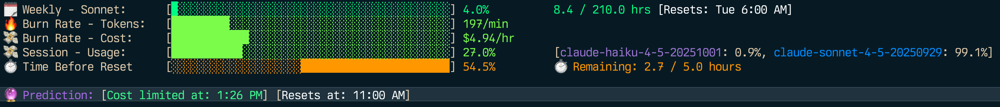

# CCU - Claude Code Usage Monitor

A performant terminal dashboard for monitoring Claude Code usage, built in Go using the Charm family of packages (Bubbletea, Lipgloss, Bubbles).



## Features

- **Live Claude API Usage Data** - Near real-time usage stats from Anthropic's servers with exact reset times
- **5-Hour Session Tracking**: Monitor rolling 5-hour usage windows with OAuth utilisation percentage
- **Weekly Limits**: Track 7-day rolling usage overall, plus a separate bar for each model Anthropic applies an individual weekly limit to
- **Real-time Dashboard**: Live updating terminal UI with colour-coded progress bars
- **Burn Rate Monitoring**: Dual burn rate display - tokens/minute and cost/hour with visual indicators
- **Intelligent Predictions**: Cost depletion time with colour-coded warnings (red if before reset, orange if close, green if safe)
- **Plan Support**: Pro, Max5, Max20
- **Setup-Token Support**: `ccu statusline` captures plan usage from Claude Code's status line for `CLAUDE_CODE_OAUTH_TOKEN` users, who can't use the OAuth usage API
- **Automatic Fallback**: Uses OAuth when available, then status line data, then JSONL with raw cost/message display (no percentages)
- **Model Distribution**: See which models you're using per session (Sonnet, Opus, Haiku)

## Installation

### Using Go Install

```bash
go install github.com/sammcj/ccu/cmd/ccu@latest
```

### From Source

```bash
git clone https://github.com/sammcj/ccu.git
cd ccu
make build
./bin/ccu
```

## Usage

### Basic Usage

```bash
# Run with default settings (Max5 plan)
ccu

# Use a different plan
ccu -plan=pro
ccu -plan=max20

# Custom plan with specific limits
ccu -plan=custom -custom-tokens=50000 -custom-cost=25 -custom-messages=500

# Interactive view modes (TUI)
ccu -view=daily    # Daily aggregation
ccu -view=monthly  # Monthly aggregation

# Static reports (stdout, no TUI)
ccu -report=monthly              # Monthly usage report
ccu -report=weekly               # Weekly usage report (last ~13 weeks)
ccu -report=daily                # Daily usage report (last 30 days)
ccu -report=daily -hours=90      # Last 90 days

# Adjust refresh rate (1-60 seconds, default: 5)
ccu -refresh=10

# Load more history (for JSONL fallback mode)
ccu -hours=48      # Last 48 hours
```

### Command-Line Flags

- `-plan` - Plan type: `pro`, `max5`, `max20`, `custom` (default: `max5`)
- `-view` - View mode: `realtime`, `daily`, `monthly` (default: `realtime`)
- `-report` - Generate static report to stdout: `daily`, `weekly`, `monthly` (bypasses TUI)
- `-refresh` - UI refresh rate in seconds, 1-60 (default: `5`). Note: OAuth data is cached for 60 seconds regardless of UI refresh rate
- `-hours` - Hours of history to load from JSONL files (default: `24`, only used in fallback mode)
- `-data` - Path to Claude data directory (default: `~/.claude/projects`, only used in fallback mode)
- `-custom-tokens` - Custom token limit (requires `-plan=custom`)
- `-custom-cost` - Custom cost limit in USD (requires `-plan=custom`)
- `-custom-messages` - Custom message limit (requires `-plan=custom`)
- `-weekly` - Show weekly usage panel (default: `true`)
- `-no-oauth` - Never call the OAuth usage API (env: `CCU_NO_OAUTH=1`). For setup-token users relying on [`ccu statusline`](#setup-token-users-ccu-statusline). The daily published pricing fetch still runs
- `-check-models` - Check ccu's model pricing and display-name tables against upstream rates (LiteLLM dataset) and exit. Exit code `1` on drift with a hint describing what to update, `2` on fetch errors. Useful in CI or for AI agents maintaining this codebase
- `-api` - Enable the embedded HTTP API server (default: `false`)
- `-api-port` - API server port (default: `19840`)
- `-api-bind` - API server bind address (default: `0.0.0.0`)
- `-api-token` - Bearer token for API auth; empty means no auth
- `-api-allow` - Comma-separated CIDR allowlist, e.g. `192.168.1.0/24,10.0.0.1/32`; empty means allow all

### Keys

- `a` - Toggle advanced detail: the 1H cache cost comparison on the `Session - Cache Hit` row
- `r` or space - Refresh now
- `q` or `ctrl+c` - Quit
- `-help` - Show help message
- `-version` - Show version information

### Keyboard Controls

- `q` or `Ctrl-C` - Exit the application

### Setup-Token Users (`ccu statusline`)

If Claude Code authenticates with `CLAUDE_CODE_OAUTH_TOKEN` (from `claude setup-token`), the OAuth usage API rejects the token, so CCU can't fetch plan usage directly. Claude Code still passes your 5-hour and weekly usage to its status line, so make `ccu statusline` the status line command in `~/.claude/settings.json`:

```json
{
  "statusLine": {
    "type": "command",
    "command": "ccu statusline",
    "refreshInterval": 30
  }
}
```

On its own it prints `5h 24% | 7d 41%`. To keep an existing status line, put its command after `--` and CCU passes the same JSON through and prints that command's output:

```json
"command": "ccu statusline -- npx -y ccstatusline@latest"
```

Each run saves the numbers to `rate-limits.json` in the user cache dir (`~/Library/Caches/ccu/` on macOS). The dashboard uses them whenever OAuth has no data. If Claude Code runs inside a sandbox, allow writes to that directory, or the status line still prints but the dashboard gets nothing.

Run the dashboard with `ccu -no-oauth` (or `CCU_NO_OAUTH=1`) so it never calls the OAuth usage API, which can't succeed with a setup-token. Without it, CCU already skips the request while the Keychain token is expired. It still calls whenever the Keychain token looks valid.

- Numbers only update while Claude Code is making requests, and claude.ai or desktop usage shows up on the next one. The dashboard labels the data with how long ago it last changed
- Claude Code only re-runs the status line on main-session events, so `refreshInterval` is needed to pick up changes while the main session is idle
- No per-model weekly bars (the status line doesn't include them)
- API key and cloud provider sessions have no plan limits, so there is nothing to capture

## HTTP API

CCU can expose its computed metrics over a local HTTP API. This is opt-in and disabled by default.

The API is intended for local network consumers such as an ESP32 display or a home-automation system. It serves the same data the TUI displays — burn rates, session/weekly utilisation, depletion predictions — with no additional API calls to Anthropic.

### Enabling

```bash
# Minimal: open to all local connections, no auth
ccu -api

# With bearer token auth
ccu -api -api-token=mysecret

# Restrict to a subnet
ccu -api -api-allow=192.168.1.0/24

# Combined: subnet + token, custom port
ccu -api -api-port=8080 -api-allow=192.168.1.0/24 -api-token=mysecret
```

Environment variables are also supported (CLI flags take precedence):

| Env var                                 | Equivalent flag |
| --------------------------------------- | --------------- |
| `CCU_API=true` or `CCU_ENABLE_API=true` | `-api`          |
| `CCU_API_PORT=19840`                    | `-api-port`     |
| `CCU_API_BIND=0.0.0.0`                  | `-api-bind`     |
| `CCU_API_TOKEN=secret`                  | `-api-token`    |
| `CCU_API_ALLOW=192.168.1.0/24`          | `-api-allow`    |

A token file at `~/.ccu/.api_token` is read as a fallback when neither flag nor env var sets a token.

### Endpoint

`GET /api/status` returns a JSON snapshot updated on every data refresh (every 60 seconds when OAuth is active).

```bash
curl -s -H "Authorization: Bearer mysecret" http://localhost:19840/api/status | jq .
```

Example response (fields are omitted when data is unavailable):

```json
{
  "plan": "max5",
  "server_time": "2026-02-18T12:00:00Z",
  "data_age_seconds": 15,
  "usage_source": "oauth",
  "usage_updated_at": "2026-02-18T11:58:00Z",
  "weekly": {
    "all_models": { "utilisation_pct": 30.5, "resets_at": "2026-02-25T00:00:00Z", "resets_in_seconds": 594000 },
    "scoped": {
      "sonnet": { "model": "Sonnet", "utilisation_pct": 25.0, "used_hours": 52.5, "limit_hours": 210, "resets_at": "...", "resets_in_seconds": 594000 },
      "fable":  { "model": "Fable",  "utilisation_pct": 45.0, "resets_at": "...", "resets_in_seconds": 594000 }
    }
  },
  "session": {
    "utilisation_pct": 42.0,
    "resets_at": "2026-02-18T15:00:00Z",
    "resets_in_seconds": 10800,
    "elapsed_seconds": 7200,
    "total_seconds": 18000,
    "remaining_seconds": 10800,
    "remaining_pct": 60.0,
    "cost_usd": 14.70,
    "message_count": 312,
    "model_distribution": [
      { "model": "claude-sonnet-4", "cost_pct": 72.5 },
      { "model": "claude-opus-4",   "cost_pct": 27.5 }
    ]
  },
  "burn_rate": {
    "tokens_per_min": 850.0,
    "cost_per_min_usd": 0.048,
    "cost_per_hour_usd": 2.88
  },
  "prediction": {
    "session_limit_at": "2026-02-18T19:30:00Z",
    "session_limit_in_seconds": 27000,
    "session_will_hit_limit": false,
    "weekly_will_hit_limit": false
  }
}
```

Returns `503` with `{"error":"no data"}` before the first data load completes.

### Security

- If both `-api-allow` and `-api-token` are unset, CCU logs a warning at startup. Only do this on a fully trusted, isolated network.
- IP allowlist is checked before auth so the existence of an auth requirement is not leaked to blocked hosts.
- `weekly` fields are only present when OAuth or `ccu statusline` data is available; they are omitted in JSONL-only mode.
- `usage_source` (`oauth` or `statusline`) and `usage_updated_at` say where the plan usage came from and when it last changed. `data_age_seconds` only covers the JSONL refresh, so check `usage_updated_at` for status line data, which can be days old.

The keys of `weekly.scoped` vary by account and change whenever Anthropic adds or drops a per-model weekly limit, so consumers should iterate the map rather than index a fixed key.
Keys are the lowercased model name, suffixed with `/<surface>` when a limit applies to one surface only (e.g. `fable/web`).
Only `model` and `utilisation_pct` are guaranteed on each entry: `used_hours` and `limit_hours` are omitted for models with no published hour allowance, since CCU would otherwise have to invent a limit it doesn't know.

## How It Works

### Data Sources

CCU uses **three data sources**, in order of preference:

#### 1. OAuth API (Primary - Requires Re-authentication)

CCU automatically fetches live usage data from Anthropic's servers when available:
- **Exact reset times** for 5-hour sessions and 7-day windows
- **Combined web + CLI usage** tracking

To enable OAuth you may need to re-authenticate Claude Code to get tokens with the required scopes:
```bash
claude logout
claude login
```

After re-authentication, CCU will automatically use OAuth data when available.

CCU reads the token from the macOS Keychain. While Claude Code authenticates with `ANTHROPIC_API_KEY`, `CLAUDE_CODE_OAUTH_TOKEN` or a cloud provider, it stops refreshing that token, so CCU falls back to JSONL once it expires. Tokens from `claude setup-token` can't read plan usage from this endpoint (they only carry `user:inference`), so setup-token users need the status line source below.

#### 2. Claude Code Status Line (Setup-Token Users)

Claude Code reads your plan utilisation from the rate limit headers on its own model responses and passes it to the status line command as `rate_limits`. It keeps these values in memory only and hooks don't receive them, so running as the status line is the only way to get them. This works with setup-tokens because no `user:profile` scope is needed. See [Setup-Token Users](#setup-token-users-ccu-statusline) for setup.

#### 3. Local JSONL Files (Degraded Fallback)

If OAuth is unavailable, CCU reads from `~/.claude/projects/**/*.jsonl` files and shows a degraded view:
- Raw session cost and message count (no progress bars or percentages)
- Burn rate (tokens/min, $/hr) -- still accurate from local data
- Session model distribution
- Time before reset (estimated from session blocks)

**Limitations**: JSONL files only contain CLI activity (no web usage). Usage percentages, weekly tracking, predictions, and limit warnings require OAuth. When OAuth fails due to a transient error, CCU automatically retries after 5 minutes.

### Data Source Comparison

| Feature                | OAuth API    | Status Line        | JSONL Fallback  |
| ---------------------- | ------------ | ------------------ | --------------- |
| Web + CLI tracking     | ✅ Yes        | ⚠️ On next request  | ❌ CLI only      |
| Usage percentages      | ✅ Yes        | ✅ Yes              | ❌ Not available |
| Weekly limits          | ✅ Yes        | ⚠️ All models only  | ❌ Not available |
| Predictions/warnings   | ✅ Yes        | ✅ Yes              | ❌ Not available |
| Burn rates             | ✅ Yes        | ✅ Yes              | ✅ Yes           |
| Session distribution   | ✅ Yes        | ✅ Yes              | ✅ Yes           |
| Exact reset times      | ✅ Yes        | ✅ Yes              | ⚠️ Estimated     |
| Works with setup-token | ❌ No         | ✅ Yes              | ✅ Yes           |
| Setup required         | Re-auth once | Status line config | None            |

### Session Blocks

Usage is grouped into 5-hour rolling session blocks. Each session tracks:
- Total tokens consumed
- Cost accumulated
- Messages sent
- Per-model statistics
- Burn rate (tokens/minute)

### Burn Rate Calculation

Burn rates are calculated using a proportional overlapping session method over the last hour:
- For each session overlapping the last 60 minutes, calculate the overlap duration
- Apply proportion of session's tokens/cost based on overlap
- Prevents double-counting when sessions overlap
- Displayed as: tokens/minute and dollars/hour

**Visual Indicators**: Burn rate bars use green→yellow→orange→red gradient based on intensity (percentage of limit at current rate).

### Model Pricing

Costs use ccu's built-in rate table. For a model missing from it, ccu reads rates from [Anthropic's pricing page](https://platform.claude.com/docs/en/about-claude/pricing), cached for 24 hours in `<user cache dir>/ccu/pricing.json`. The page is fetched at most once per run. If the model still isn't found (or you're offline), ccu uses the model family's current rate and marks those costs as estimates. The page also sets what an unversioned name such as `sonnet` means: the newest generally available release of that family it lists. ccu refreshes the cached page in the background at startup once it's a day old. Models priced by prompt length (Haiku 5.5 charges more above 100k prompt tokens) are costed per request, counting input, cache write and cache read tokens. Cache writes are split per request into 5-minute (1.25x input) and 1-hour (2x input) writes, using the breakdown Claude Code records for each response. The `Session - Cache Hit` row ends with the share of the session's cache writes that went to the 1-hour cache, then, with advanced detail on (`a`), what the session cost against the 5-minute cache, e.g. `(+$11.75 of $124.72 vs 5m)`, where $124.72 is the session cost so far. Each conversation is replayed with the 5-minute cache, so a cache read more than 5 minutes (and at most an hour) after the previous request is costed as a rewrite. Green means the 1-hour cache paid off. Amber means the 5-minute cache would have been up to 5% cheaper, orange more than that. When subagents wrote to the 1-hour cache, their part of the session follows separately, e.g. `(+$3.17 of $181.26 vs 5m; agents +$18.40 of $140.03)`. The agents figure is included in the first one. Subagents rarely sit idle for more than 5 minutes, so the 1-hour cache tends to cost them more. Fast mode requests (`/fast`) are costed at the model's fast mode premium (2x on Opus 5.5, Opus 5 and Opus 4.8) on every rate, including cache. Models without fast mode, such as Opus 4.6, bill fast requests at standard rates.

### Predictions

The tool provides intelligent cost depletion predictions:
- **Cost Depletion Time**: When you'll hit the cost limit based on current burn rate (calculated from last hour)
- **Session Reset Time**: When the 5-hour window expires (from OAuth or estimated)

**Colour-Coded Warnings**:
- 🔴 **Red**: Depletion time is BEFORE reset (you'll be cut off)
- 🟠 **Orange**: Depletion time is within 30 minutes AFTER reset (close call - usage spike could cut you off)
- 🟢 **Green**: Depletion time is 30+ minutes after reset (safe)

Cost-based predictions are more accurate than token-based for mixed-model usage because different models have different costs per token.

### Weekly Tracking

Weekly limits are tracked over a rolling 7-day window. CCU shows an "All Models" bar plus one bar per model
that Anthropic currently applies an individual weekly limit to.

Which models those are is read from the `limits` array in the OAuth usage API response, where each per-model
limit arrives as a `weekly_scoped` entry naming its model. Nothing is hardcoded, so when Anthropic adds a
limit for a new model (as it did for Fable) the bar appears without a CCU update.

Where the plan publishes an hour allowance for a model, the bar shows hours used against it. Where it doesn't,
the bar shows the reset time instead of an invented limit.

## Plan Limits

As of 2025-12-01

### Pro Plan
- Cost: $18 per 5-hour session
- Messages: ~250 per 5-hour session (estimated)
- Weekly: ~60 hours Sonnet

### Max5 Plan
- Cost: $35 per 5-hour session
- Messages: ~1,000 per 5-hour session (estimated)
- Weekly: ~210 hours Sonnet, ~25 hours Opus

### Max20 Plan
- Cost: $140 per 5-hour session
- Messages: ~2,000 per 5-hour session (estimated)
- Weekly: ~360 hours Sonnet, ~32 hours Opus

## Customisation

### Colours

All colours and their mappings are centralised in `internal/ui/styles.go` (lines 9-127):

- **Colour definitions**: Edit hex values for model colours (Sonnet/Opus/Haiku), UI elements, and gradients
- **Element mappings**: Documentation showing which UI element uses which colour (weekly bars, burn rates, session usage, time remaining, predictions)

To customise colours:
1. Edit `internal/ui/styles.go`
2. Find your element in the mappings section (lines 92-127)
3. Change the corresponding colour value (lines 16-90)
4. Run `make build`

### Project Structure

```
ccu/
├── cmd/ccu/          # Entry point
├── internal/
│   ├── api/          # Optional embedded HTTP API server
│   ├── app/          # Bubbletea application (MVU pattern)
│   ├── oauth/        # OAuth client for Anthropic API
│   ├── statusline/   # `ccu statusline` capture of Claude Code's rate limits
│   ├── data/         # JSONL reading and parsing (fallback)
│   ├── analysis/     # Session blocks, burn rate, predictions
│   ├── models/       # Data structures
│   ├── pricing/      # Model pricing calculations
│   ├── ui/           # Dashboard rendering and colour logic
│   └── config/       # Configuration management
└── Makefile
```

## Licence

- [Apache 2.0](LICENSE)
